<p align="center">
  <a href="https://tareeq-rak.vercel.app">
    
  </a>
</p>

<p align="center">
  <a href="https://tareeq-rak.vercel.app"></a>
  &nbsp;
  <a href="https://github.com/SohamBhongade/Tareeq/actions/workflows/build-apk.yml"></a>
</p>

<p align="center">
  
  
  
  
  
  
  
  
</p>

<h3 align="center">A pothole, a broken light, a pile of rubbish.<br>Take one photo. Tareeq does the rest.</h3>

<p align="center">
  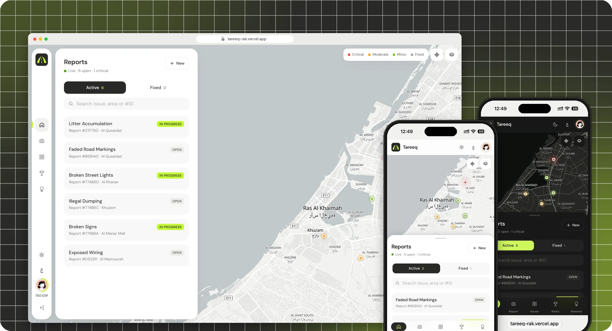
</p>

## 🎬 Launch video

<p align="center">
  <a href="https://github.com/SohamBhongade/Tareeq/blob/main/docs/tareeq/Tareeq_launch.mp4">
    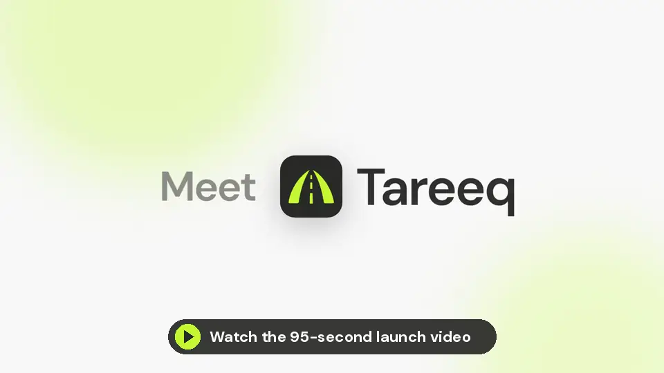
  </a>
  <br>
  <sub>▶ Click the preview to watch the full 95-second video with sound &nbsp;·&nbsp; <a href="https://github.com/SohamBhongade/Tareeq/raw/main/docs/tareeq/Tareeq_launch.mp4">download MP4</a></sub>
</p>

---

**Tareeq** (طريق, Arabic for *"road"* or *"the way"*) helps the residents of Ras Al Khaimah report street problems and get them fixed. A resident photographs the issue. **Google Gemini** works out what it is, scores how dangerous it is and writes a description in **English and Arabic**. The report drops onto a **live city map** with its exact GPS location and street address. City crews take the serious jobs. Small jobs, like litter or graffiti, go to **community volunteers**, whose before-and-after photos a City Admin checks before they earn points.

It runs as a **website** that works on any laptop or phone, and as an **Android app** that opens the same site full-screen. Both share one database, so a report from either one appears everywhere within seconds.

<table>
  <tr>
    <td width="33%" valign="top">
      <h4>📸 One photo, no forms</h4>
      The AI picks the category, severity and description. GPS and the street address fill in automatically.
    </td>
    <td width="33%" valign="top">
      <h4>🗺️ Live city map</h4>
      Every report is colour-coded by danger. The list refreshes every 3 seconds, with no page reload.
    </td>
    <td width="33%" valign="top">
      <h4>🧹 Volunteers can fix it</h4>
      Minor issues become community tasks. A City Admin approves the proof photo before the issue closes.
    </td>
  </tr>
  <tr>
    <td valign="top">
      <h4>🔁 No duplicate reports</h4>
      Same problem within 60 m? Residents confirm the existing report instead, so the city sees how many people are affected.
    </td>
    <td valign="top">
      <h4>🛡️ Fake photos refused</h4>
      AI-generated images are caught by their file labels, by the vision model and by a server-side lock.
    </td>
    <td valign="top">
      <h4>🏆 EXP, badges and avatars</h4>
      Residents earn EXP for reporting and fixing, climb the leaderboard and unlock badges and avatars.
    </td>
  </tr>
  <tr>
    <td valign="top">
      <h4>🌐 English · العربية</h4>
      The whole site switches to Arabic and right-to-left in one tap, including AI descriptions and emails.
    </td>
    <td valign="top">
      <h4>🌙 Light and dark mode</h4>
      A circular reveal animation, plus a dark map tuned to the Tareeq green.
    </td>
    <td valign="top">
      <h4>📱 Built for phones</h4>
      An Apple Maps-style sliding sheet, safe areas for the notch, and testing from 320 to 430 px wide.
    </td>
  </tr>
</table>

## Contents

- [Launch video](#-launch-video)
- [Try it now](#-try-it-now)
- [How it works](#-how-it-works)
- [Feature tour](#-feature-tour)
- [The rules behind every report](#-the-rules-behind-every-report)
- [Architecture](#-architecture)
- [Tech stack](#-tech-stack)
- [Run it yourself](#-run-it-yourself)
- [Repository layout](#-repository-layout)
- [From FixMyStreet AI to Tareeq](#-from-fixmystreet-ai-to-tareeq)
- [Team](#-team)

---

## 🚀 Try it now

| | |
|---|---|
| 🌐 **Website** | **[tareeq-rak.vercel.app](https://tareeq-rak.vercel.app)**: works in any browser, on laptop or phone |
| 🤖 **Android app** | Open the **[Actions](https://github.com/SohamBhongade/Tareeq/actions/workflows/build-apk.yml)** tab, choose the latest green *Build Tareeq APK* run and download **Tareeq-apk**. Unzip it and install `Tareeq.apk` |
| 👤 **Demo resident** | `Resident1` / `123` |
| 🛡️ **Demo City Admin** | `CityAdmin` / `12345` |

You can also create your own account on the sign-up page. Tareeq emails a 6-digit code to confirm the address.

---

## ⚡ How it works

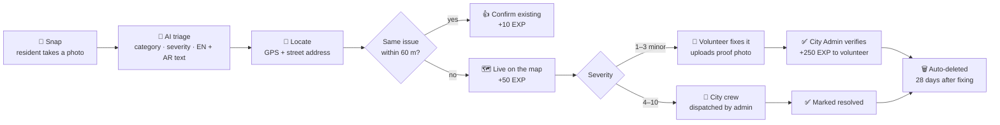

---

## 🧭 Feature tour

### 1 · Report a problem in seconds

<table>
  <tr>
    <td align="center" width="25%">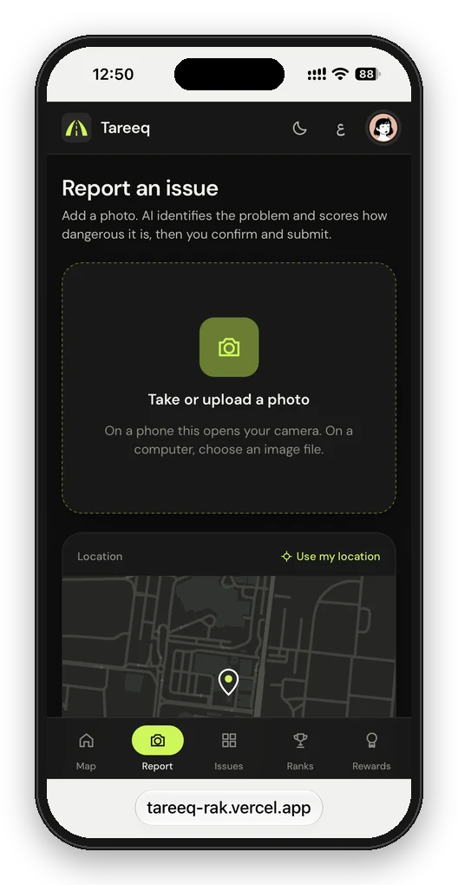<br><sub><b>Take or upload a photo</b></sub></td>
    <td align="center" width="25%">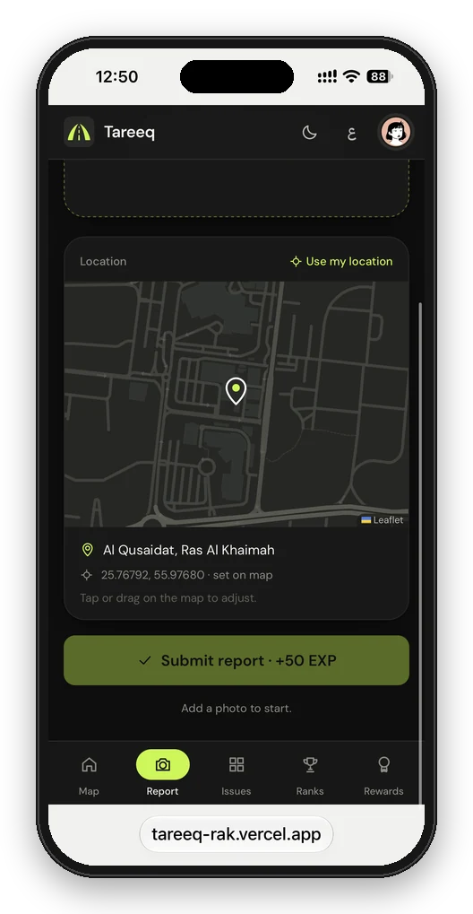<br><sub><b>Pin the exact spot</b><br>GPS, or tap the map</sub></td>
    <td align="center" width="50%">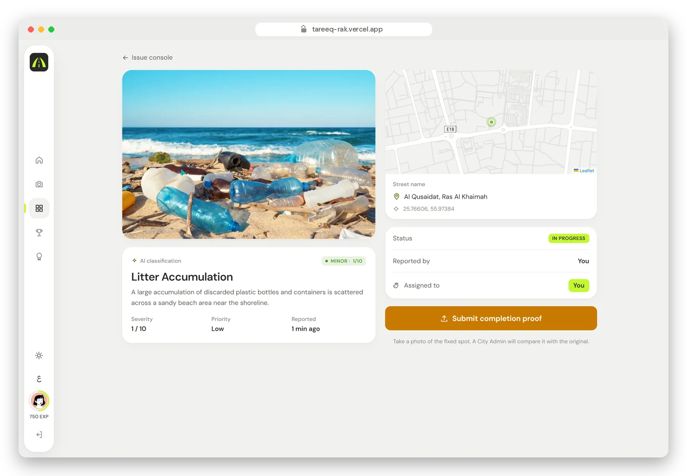<br><sub><b>The finished report</b>: AI classification, map, street and coordinates</sub></td>
  </tr>
</table>

- **AI triage.** Gemini looks at the photo and returns one of 15 categories, a 1–10 severity and a short description in English and Arabic. Each category has a fixed severity set by the city, which overrides the AI's guess, so an AI mistake can never send a dangerous job to a volunteer.
- **Exact location.** The phone's GPS fixes the coordinates and the street address is looked up automatically (Google Geocoding when a key is set, OpenStreetMap otherwise). Location is only asked for when you tap *Use my location*, with clear help messages for Android and iPhone.
- **Duplicate check.** Before submitting, Tareeq searches for an open report of the same kind within 60 m (25 m for *Other*). You can confirm that report instead (+10 EXP) or file a new one anyway.
- **Fake-photo protection** in three layers:
  1. **File labels.** Most AI image tools (Gemini/Imagen, ChatGPT/DALL·E, Midjourney, Firefly, Stable Diffusion and others) stamp their files with metadata. The browser reads it before the photo is shrunk and refuses the photo straight away.
  2. **Vision check.** The AI model also judges the picture itself, which catches AI images whose labels were stripped (screenshots, WhatsApp forwards).
  3. **Server lock.** Only a photo that passed gets a signed *photo pass* tied to that exact image and user. The server refuses any report without one, so skipping the check in the browser doesn't work.

### 2 · A live map of the whole city

<table>
  <tr>
    <td align="center" width="70%">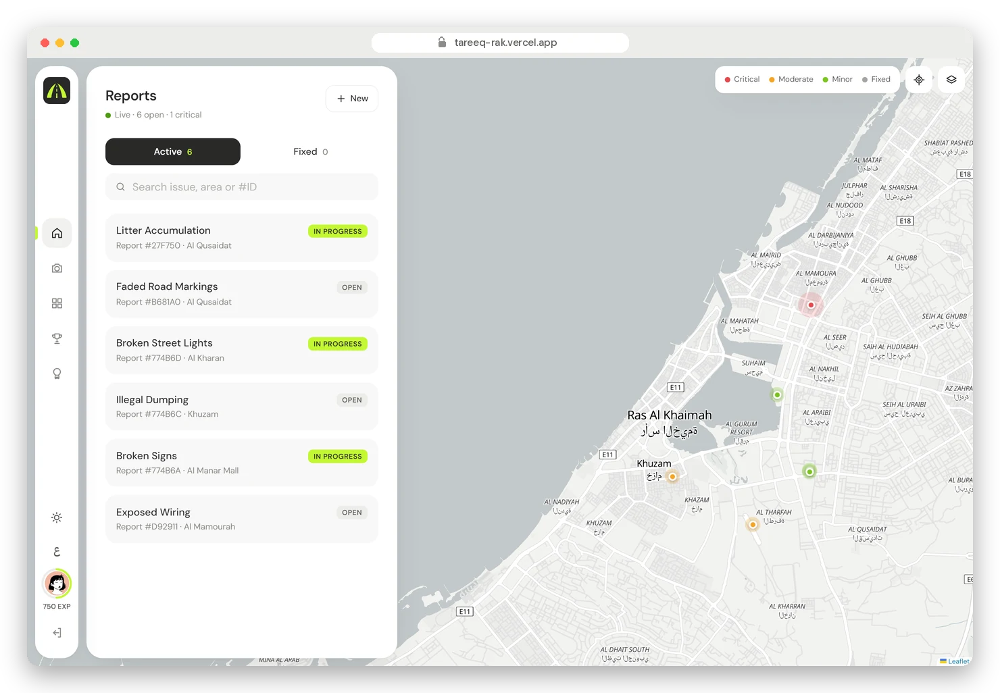<br><sub>Desktop: icon rail and reports list floating over the map</sub></td>
    <td align="center" width="30%">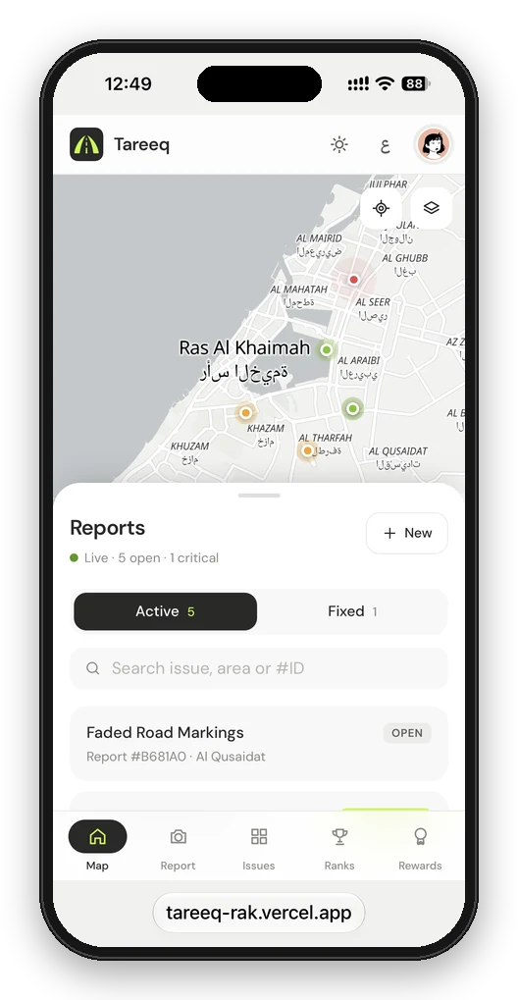<br><sub>Phone: full-width map with a sliding sheet</sub></td>
  </tr>
</table>

- Markers are colour-coded **🔴 critical · 🟠 moderate · 🟢 minor · ⚪ fixed**.
- **Active / Fixed** tabs and search by issue, area or report ID (`#27F750`).
- The list refreshes every **3 seconds**, with a *Live* / *Reconnecting* indicator.
- Tap a report to expand it: status bar, severity, reporter, who will fix it, and a button to show it on the map.
- Free maps from **OpenFreeMap** with no API key. Google Maps is used instead if a key is set.

### 3 · Issue console and issue page

<table>
  <tr>
    <td align="center" width="62%">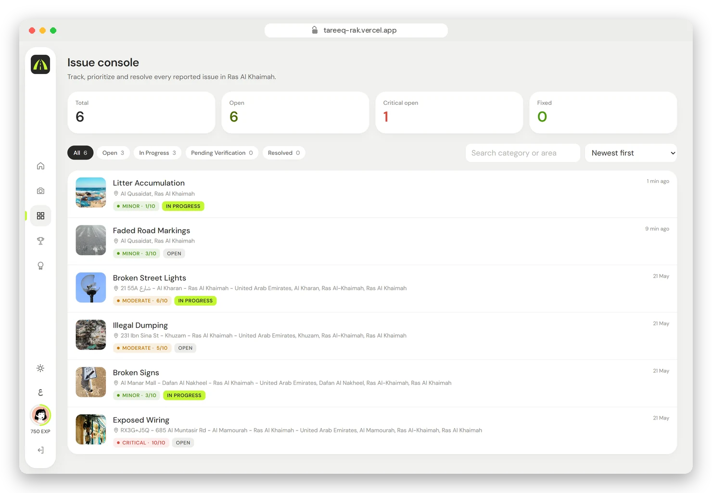<br><sub>Totals, filters by status, search and sorting</sub></td>
    <td align="center" width="19%">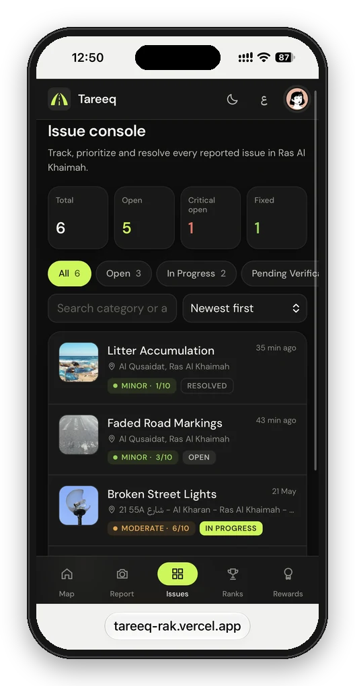<br><sub>Console on a phone</sub></td>
    <td align="center" width="19%">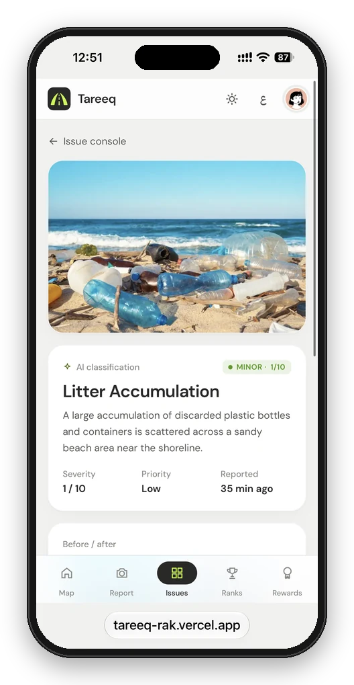<br><sub>Issue page</sub></td>
  </tr>
</table>

The console shows **Total · Open · Critical open · Fixed**, filters for every status, and sorting by newest, most severe or most confirmed. Each issue page holds the photo, AI classification, a mini map with street and coordinates, who reported it and who else has seen it, the assigned volunteer, before/after proof photos, and the date it will be deleted once resolved.

### 4 · Volunteer → proof → verify

<table>
  <tr>
    <td align="center" width="33%">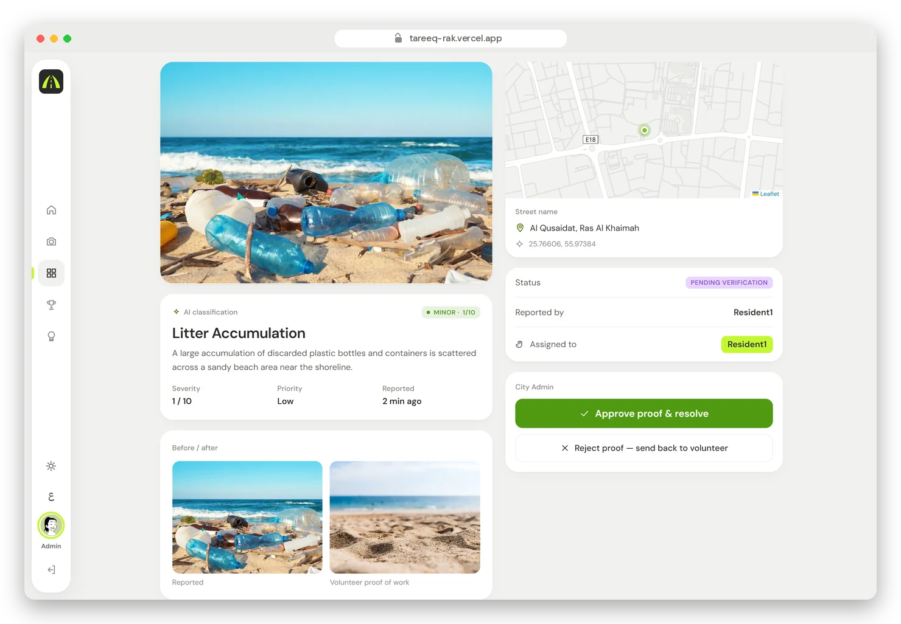<br><sub><b>1 · Volunteer uploads proof</b></sub></td>
    <td align="center" width="33%">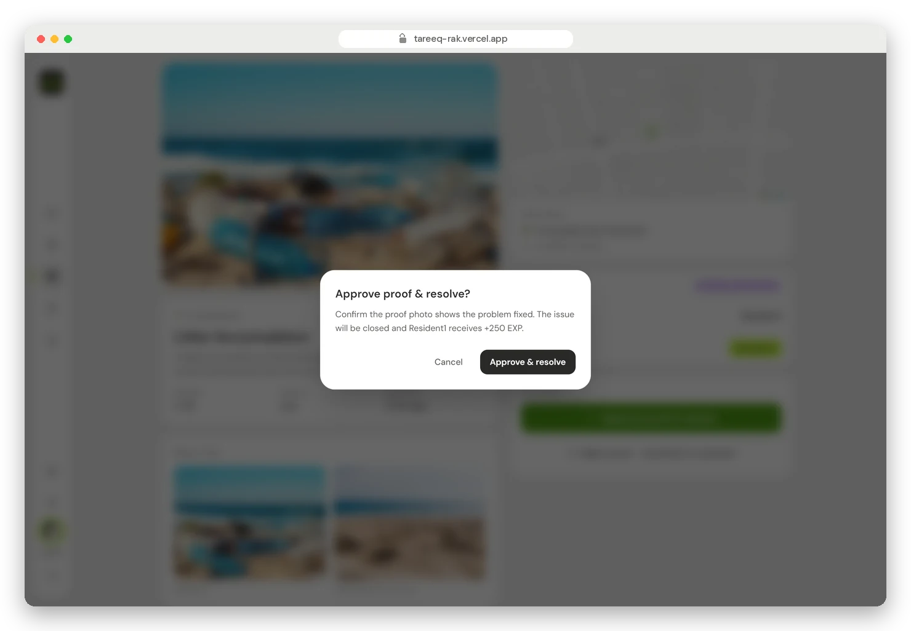<br><sub><b>2 · City Admin verifies and approves</b></sub></td>
    <td align="center" width="33%">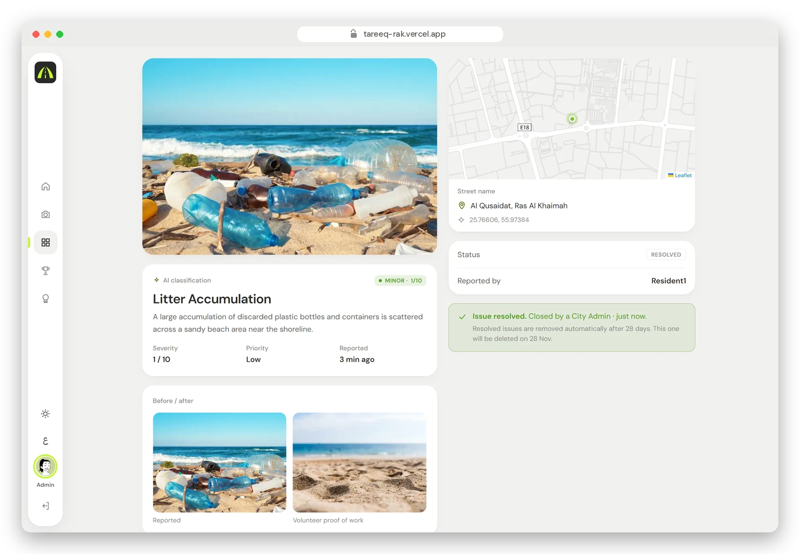<br><sub><b>3 · Resolved, +250 EXP</b></sub></td>
  </tr>
</table>

Only **minor issues (severity 1–3)** can be claimed by a volunteer, and only one volunteer at a time. The volunteer uploads an *after* photo. A City Admin compares it with the original and either **approves** it (the issue closes and the volunteer earns 250 EXP) or **rejects** it (the task goes back to the volunteer). Admins can also dispatch a city crew for bigger jobs and mark any issue resolved.

### 5 · EXP, badges, avatars and the leaderboard

<table>
  <tr>
    <td align="center" width="25%">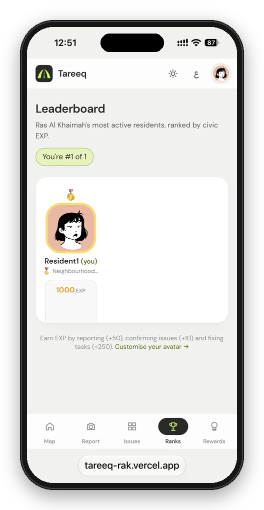<br><sub>Leaderboard podium</sub></td>
    <td align="center" width="25%">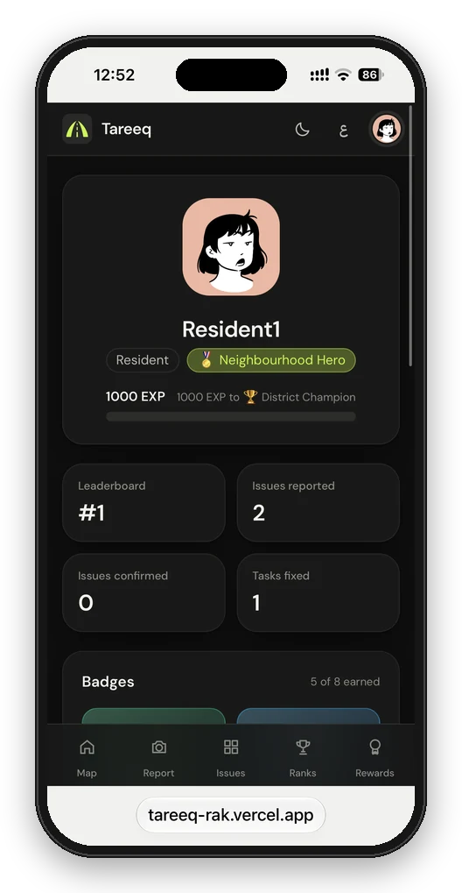<br><sub>Profile and badges</sub></td>
    <td align="center" width="25%">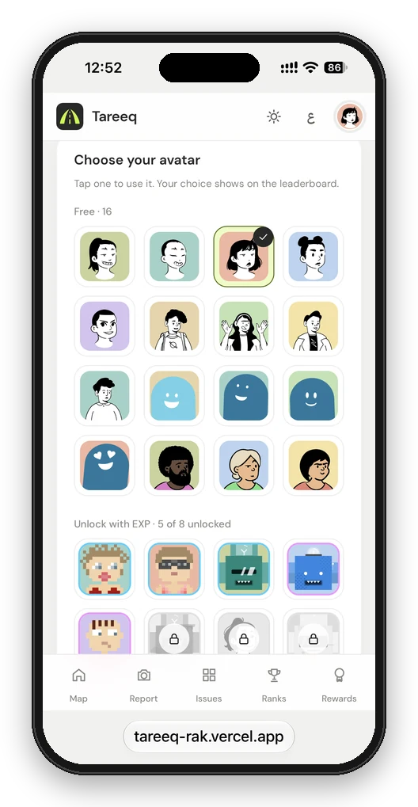<br><sub>Choose your avatar</sub></td>
    <td align="center" width="25%">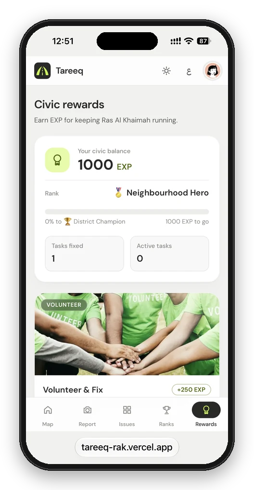<br><sub>Civic rewards</sub></td>
  </tr>
</table>

| Action | EXP |
|---|:---:|
| 📸 Report an issue | **+50** |
| 👍 Confirm someone else's report | **+10** |
| 🧹 Volunteer, fix and get verified | **+250** |
| 🌱 New resident starting balance | 100 |

**8 badges** unlock automatically as EXP grows: 🌱 Newcomer (0) → Spotter (150) → Helper (300) → Street Guardian (500) → Neighbourhood Hero (1,000) → District Champion (2,000) → City Guardian (3,500) → 👑 RAK Legend (5,000).
**29 avatars**: 21 free, plus 8 that unlock with EXP, from *Pixel Scout* at 150 to the legendary *RAK Legend* at 5,000. City Admins don't appear on the leaderboard.

### 6 · English and Arabic

<table>
  <tr>
    <td align="center" width="56%">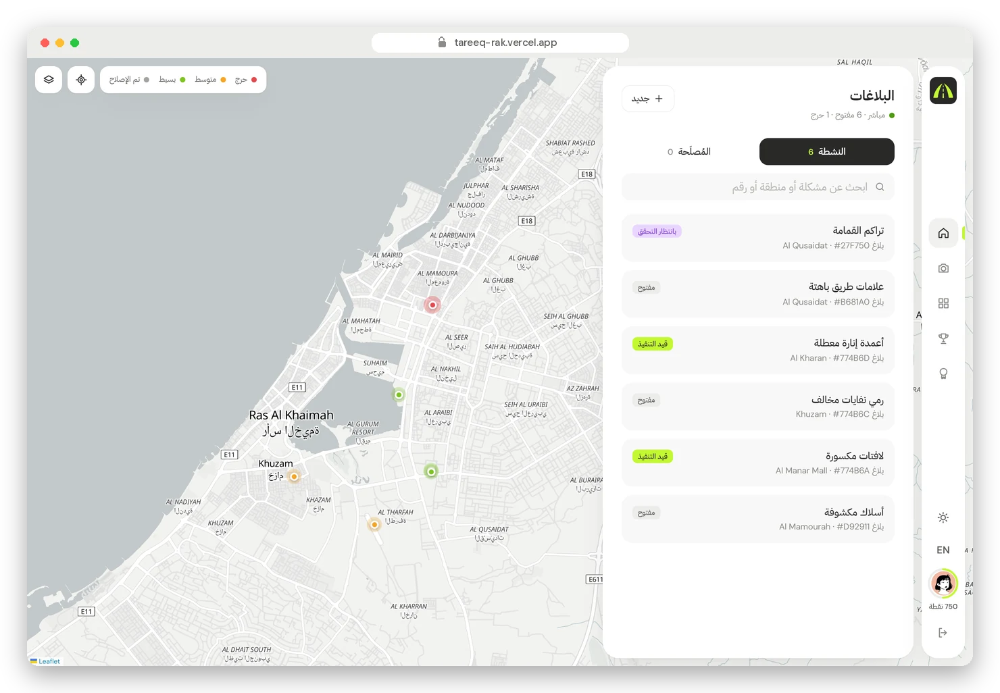<br><sub>The whole site in Arabic, right-to-left</sub></td>
    <td align="center" width="22%">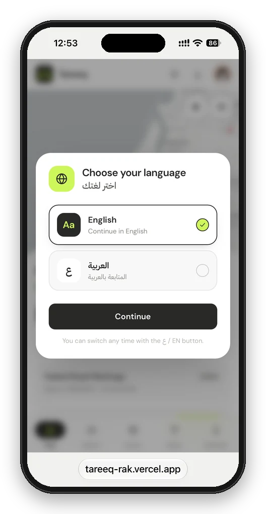<br><sub>Language choice after sign-in</sub></td>
    <td align="center" width="22%">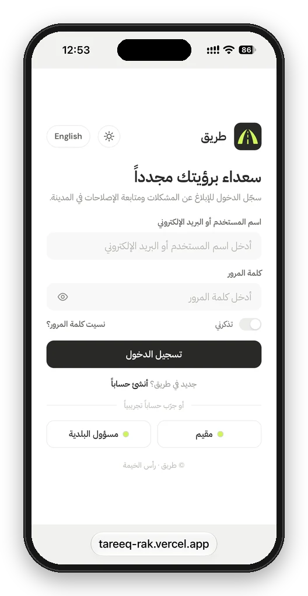<br><sub>Arabic sign-in</sub></td>
  </tr>
</table>

After every sign-in, a popup asks **English or العربية**. Arabic switches the whole interface to right-to-left with the IBM Plex Sans Arabic font. You can switch any time with the **ع / EN** button. New reports get an Arabic description from the AI, and sign-up and password emails arrive in the chosen language.

### 7 · Dark mode

<table>
  <tr>
    <td align="center" width="70%">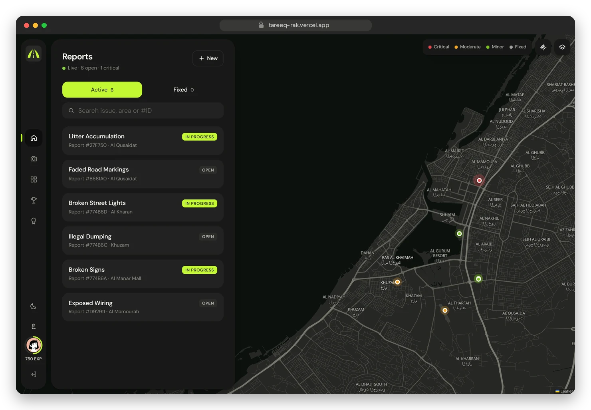<br><sub>Dark map styled like Apple Maps at night, in Tareeq green</sub></td>
    <td align="center" width="30%">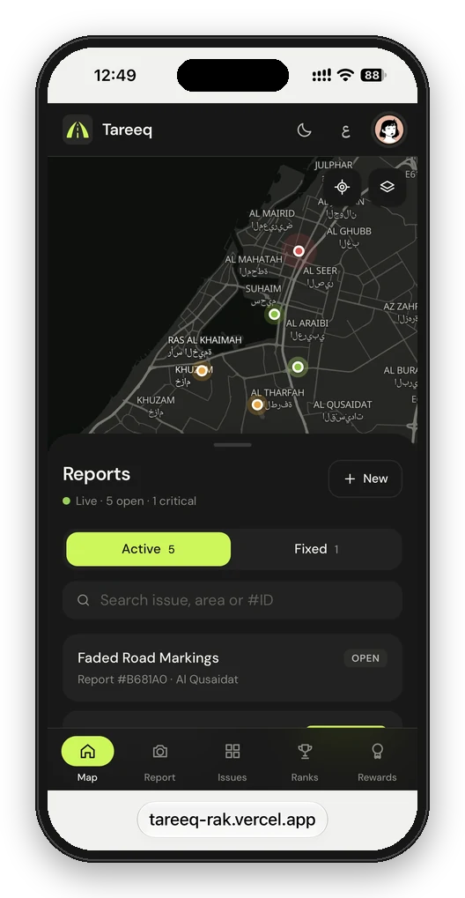<br><sub>Dark mode on a phone</sub></td>
  </tr>
</table>

A sun/moon switch in the sidebar, phone header and sign-in page flips the theme with a circular reveal animation. The browser remembers your choice. The dark map keeps coastlines, sea and borders clearly visible.

### 8 · Sign in and accounts

<table>
  <tr>
    <td align="center" width="50%">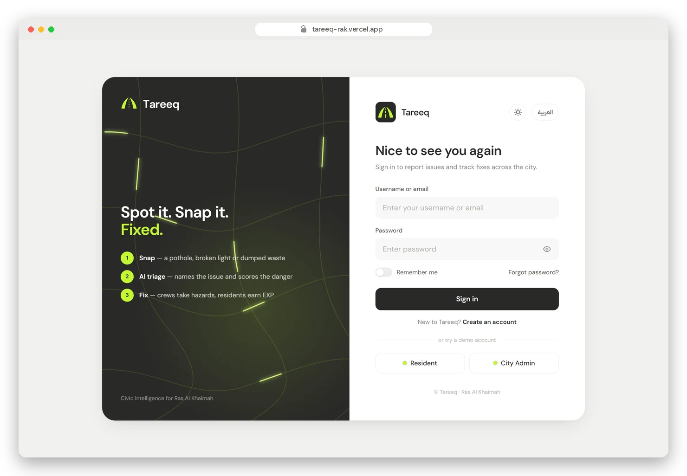<br><sub>Light sign-in</sub></td>
    <td align="center" width="50%">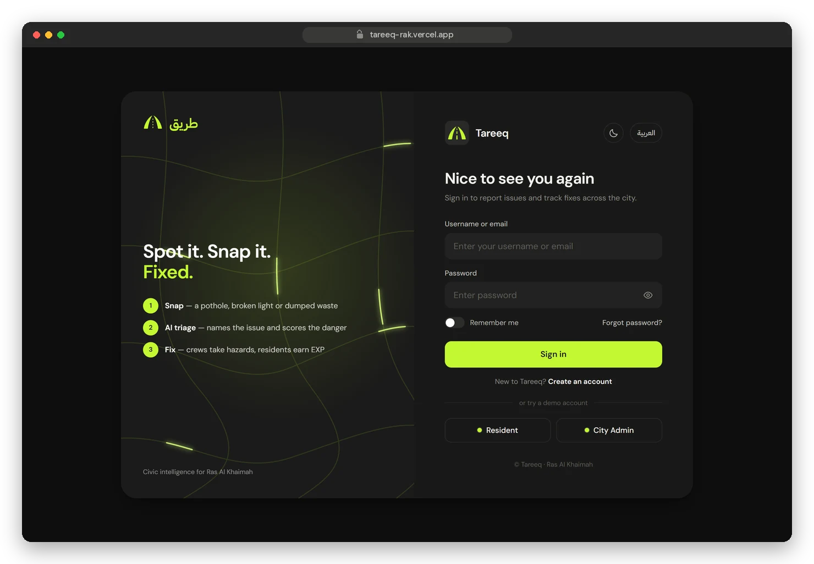<br><sub>Dark sign-in with moving "live roads"</sub></td>
  </tr>
</table>

- Sign up with a username, email and password, then confirm with a **6-digit email code** (valid 10 minutes, 5 tries, resend after 45 s). *Forgot password* works the same way.
- Without **Remember me**, a session ends when the browser closes (12 hours at most). With it, the session lasts 30 days.
- Passwords are stored only as **scrypt** hashes, and sessions use signed cookies.

### 9 · The Android app

The app in [`website-android/`](website-android) is a light **WebView container** around the live site, so every website update reaches the app with no rebuild. It supports:

- 📷 Camera and gallery uploads
- 📍 GPS permission
- ⬅️ The back button, which steps through page history
- 📶 An offline screen with *Try again*, in English and Arabic
- 🔗 WhatsApp, phone, email and map links, which open in their own apps
- ↔️ Right-to-left layouts

GitHub Actions builds the APK automatically on every push ([`build-apk.yml`](.github/workflows/build-apk.yml)).

---

## 📐 The rules behind every report

<details>
<summary><b>15 issue categories and their fixed severity</b></summary>

| Category | Severity | Band | Who fixes it |
|---|:---:|:---:|---|
| Exposed Wiring | 10 | 🔴 Critical | City crew |
| Broken Pipelines | 10 | 🔴 Critical | City crew |
| Potholes | 8 | 🔴 Critical | City crew |
| Traffic Signal Malfunction | 8 | 🔴 Critical | City crew |
| Broken Guardrails | 7 | 🔴 Critical | City crew |
| Broken Street Lights | 6 | 🟠 Moderate | City crew |
| Water Accumulation | 5 | 🟠 Moderate | City crew |
| Cracked Sidewalks | 5 | 🟠 Moderate | City crew |
| Illegal Dumping | 5 | 🟠 Moderate | City crew |
| Overflowing Bins | 4 | 🟠 Moderate | City crew |
| Graffiti | 3 | 🟢 Minor | Volunteer or crew |
| Broken Signs | 3 | 🟢 Minor | Volunteer or crew |
| Faded Road Markings | 3 | 🟢 Minor | Volunteer or crew |
| Overgrown Vegetation | 2 | 🟢 Minor | Volunteer or crew |
| Litter Accumulation | 1 | 🟢 Minor | Volunteer or crew |

Anything that fits none of these is filed as **Other** and categorised by hand. All categories live in one file: [`website/src/lib/categories.ts`](website/src/lib/categories.ts).

</details>

<details>
<summary><b>Status lifecycle</b></summary>

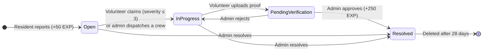

| Status | Progress bar |
|---|:---:|
| Open | 12% |
| In Progress | 50% |
| Pending Verification | 80% |
| Resolved | 100% |

</details>

---

## 🏗 Architecture

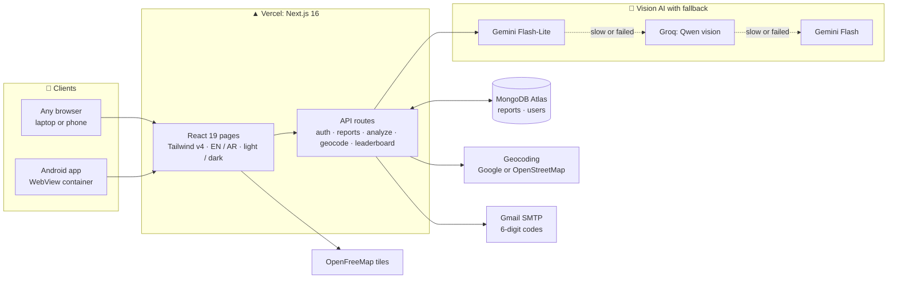

- **AI fallback chain.** Each step has a hard time limit, so the page never hangs. If no AI key is set, the site runs in **demo mode** with sample answers and a banner says so.
- **Keys stay on the server.** API keys and the database password are never sent to the browser.
- **Speed.** Report photos are served as small cached WebP thumbnails, avatars and logos are cached for a week, the database connects at start-up, and the dark map is pre-coloured so it draws once.
- **Tidy data.** Resolved issues are deleted automatically 28 days after they were fixed, and the issue page shows the deletion date.

---

## 🧰 Tech stack

| Layer | Technology |
|---|---|
| Frontend | **Next.js 16** (App Router), **React 19**, **TypeScript**, **Tailwind CSS v4**, DM Sans and IBM Plex Sans Arabic |
| AI | **Google Gemini** (`@google/genai`) with a structured JSON schema; **Groq** as the backup |
| Database | **MongoDB Atlas**, shared by the website and the Android app |
| Maps | **MapLibre** + **OpenFreeMap** (Leaflet fallback, optional Google Maps) |
| Auth | scrypt password hashes, signed session cookies, email codes via **Nodemailer** + Gmail |
| Hosting | **Vercel**, which redeploys on every push to `main` |
| Android | Java WebView app (minSdk 26, targetSdk 34), APK built by **GitHub Actions** |

---

## 💻 Run it yourself

You need **Node.js 22** or newer.

```bash
git clone https://github.com/SohamBhongade/Tareeq.git
cd Tareeq/website
npm install
cp .env.example .env.local      # Windows: copy .env.example .env.local
npm run dev                     # → http://localhost:3000
```

| Variable in `.env.local` | What it is |
|---|---|
| `GEMINI_API_KEY` | Free key from [Google AI Studio](https://aistudio.google.com/app/apikey) |
| `GROQ_API_KEY` | Optional free backup key from [Groq](https://console.groq.com/keys) |
| `MONGODB_URI` | Your MongoDB Atlas connection string |
| `SESSION_SECRET` | Any long random text |
| `GMAIL_USER` / `GMAIL_APP_PASSWORD` | Optional. Sends sign-up codes (needs a 16-letter Google App Password) |

With no AI key or database, the site still runs in **demo mode** with sample reports. Full setup, Google Maps keys and troubleshooting are in **[`website/README.md`](website/README.md)**. Building the Android app is covered in **[`website-android/README.md`](website-android/README.md)**.

---

## 📁 Repository layout

```
Tareeq/
├── website/                 ← Tareeq website (Next.js) · deployed to Vercel
│   ├── src/app/             pages: login · signup · map · report · issues · leaderboard · profile · rewards
│   ├── src/app/api/         server routes
│   ├── src/lib/             AI, categories, reports rules, database, auth, i18n
│   └── public/              brand, avatars, sample data
├── website-android/         ← Android app (WebView container)
├── .github/workflows/       ← build-apk.yml: builds the APK on every push
├── docs/
│   ├── tareeq/              README images
│   └── FIXMYSTREET_FLUTTER_APP.md   docs for the original Flutter app
└── lib/, android/, ios/ …   ← original FixMyStreet AI Flutter app (archived)
```

---

## 🛣 From FixMyStreet AI to Tareeq

| When | What happened |
|---|---|
| **May 2026** | **FixMyStreet AI**, a Flutter mobile app with Llama 4 Scout vision AI and MongoDB, built for the **ADU hackathon** |
| **Oct 2026** | Rebuilt as a **website**, renamed **Tareeq**, and moved to **Google Gemini**. Added Arabic, duplicate detection, a new UI, dark mode and the phone layout |
| **Oct 2026** | Went live on **Vercel**. The **Android app** became a container for the website |
| **Nov 2026** | Added fake-photo protection, more avatars and smoother location handling. Entered in the **RAK Department of Knowledge × Google** hackathon |

The original Flutter app is still in this repository. Its full documentation, with screenshots, is in **[docs/FIXMYSTREET_FLUTTER_APP.md](docs/FIXMYSTREET_FLUTTER_APP.md)**.

---

## 👥 Team

<table>
  <tr>
    <td align="center"><b>Soham Bhongade</b></td>
    <td align="center"><b>Abhinav Arul</b></td>
    <td align="center"><b>Aneeq Mohammed</b></td>
    <td align="center"><b>Nithik Dev</b></td>
  </tr>
</table>

<p align="center"><sub>Indian Public High School Private · Ras Al Khaimah, UAE</sub></p>

<details>
<summary><b>Credits</b></summary>

- Avatars: [DiceBear](https://dicebear.com) styles Lorelei, Notionists, Thumbs, Pixel Art and Open Peeps (CC0), and Bottts (free for personal and commercial use)
- Map © [OpenFreeMap](https://openfreemap.org) · [OpenMapTiles](https://www.openmaptiles.org/) · data © [OpenStreetMap](https://www.openstreetmap.org/copyright) contributors
- Fonts: [DM Sans](https://fonts.google.com/specimen/DM+Sans) and [IBM Plex Sans Arabic](https://fonts.google.com/specimen/IBM+Plex+Sans+Arabic) (SIL Open Font License)

</details>

<p align="center">
  <br>
  <a href="https://tareeq-rak.vercel.app"></a><br>
  <b>Tareeq · طريق</b><br>
  <sub>Spot it. Snap it. Fixed.</sub>
</p>
